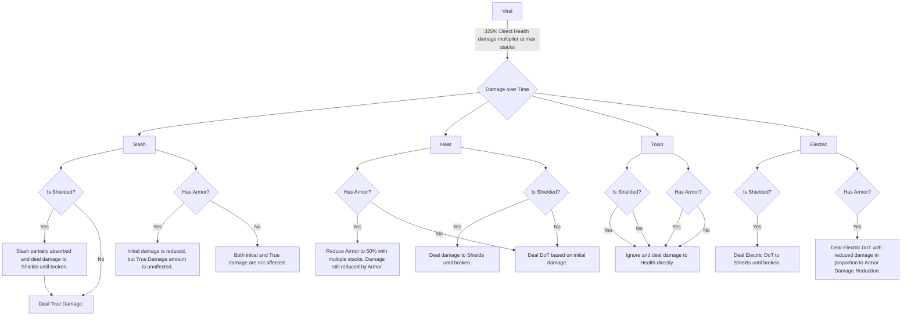

---
{"dg-publish":true,"permalink":"/documents/priority-spliced-traits/","created":"2026-10-21T07:35:54.942-04:00","updated":"2026-10-21T10:38:25.949-04:00","dg-note-properties":{}}
---

> [!TIP] Tips
> - A **negative** Riven trait Spliced into a **positive** Riven trait will create a **positive** Spliced trait.
> - Ensure you have 4 traits beforehand as splicing a Riven **preserves** its layout. Additional rerolls with 2-3 traits will never get more than 2-3 traits respectively.
> - Blast damage is affected by Critical Damage calculation.
> - High Status Chance is always recommended due to the nature of [[Arcanes/Primary Weapon Arcanes/Primary Debilitate\|Primary Debilitate]] and [[Arcanes/Secondary Weapon Arcanes/Secondary Encumber\|Secondary Encumber]].

| Priority Ranking | Spliced Trait              | Required Trait 1      | Required Trait 2 | Notes                                                                                                                                                                                                                                                                                                                                                                      |
| ---------------- | -------------------------- | --------------------- | ---------------- | -------------------------------------------------------------------------------------------------------------------------------------------------------------------------------------------------------------------------------------------------------------------------------------------------------------------------------------------------------------------------- |
| S                | Status Damage              | Damage / Melee Damage | Status Chance    | Affects **all** damage dealt by Status Effects. Also increases Blast damage which is multiplicatively 330% of the original damage dealt *with* Critcal Damage calculations.                                                                                                                                                                                                |
| S                | Viral                      | Toxin                 | Cold             | Best paired with Cold or Heat on the Riven to create Blast.                                                                                                                                                                                                                                                                                                                |
| S                | Blast                      | Cold                  | Heat             |                                                                                                                                                                                                                                                                                                                                                                            |
| A+               | Weak Point Damage          | Zoom                  | Damage           | Only on precision weapons. Toxin is calculated only from non-critical damage calculations.                                                                                                                                                                                                                                                                                 |
| A                | Weak Point Critical Chance |                       |                  | Remember that Critical Chance caps out at 600% Critical Chance, which is easier than ever to achieve with the help of other Warframes. As a result, it's advisable to build for Critical Damage instead so you will deal higher Critical Damage even when your Critical Chance caps out at 600% Critical Chance, indicated by !!! marks at the end of your damage numbers. |

# Recommended Layouts

Below are the recommended traits to be paired with the Spliced Trait as indicated in **bold**. The order of the traits ultimately does not matter.  

> [!WARNING]
> The recommended traits should be determined on a **case by case** basis, so do not take the advice here as if it was written in stone.
> 
> > [!EXAMPLE]- Example Case: Destreza Incarnon
> > For example, Destreza's Incarnon increases its Damage from [[Weapons/Incarnon/Incarnon Genesis/Melee/Destreza Incarnon Genesis#Evolution `I` Incarnon Form\|Heavy Attack kills]] in Incarnon Form, Status Chance with [[Weapons/Incarnon/Incarnon Genesis/Melee/Destreza Incarnon Genesis#Evolution `II` Piercing Stature\|Piercing Stature]] **and** Critical Chance with [[Weapons/Incarnon/Incarnon Genesis/Melee/Destreza Incarnon Genesis#Evolution `IV` Decisive Stature\|Decisive Stature]], but it's not done equally with the Critical Chance needing a little bit of help with [[Mods/Melee/Blood Rush\|Blood Rush]] and the Critical Damage increased with [[Arcanes/Melee Weapon Arcanes/Melee Doughty\|Melee Doughty]] (which makes high Puncture damage a requirement). Destreza also struggles with area coverage with its spectral rapiers, which makes Blast a desirable status effect. However, Blast shouldn't be the spliced trait as you also want to maximize the damage dealt which leads us to Viral which is immediately maxed out due to the high Status Chance.
> > 
> > In this case, a Spliced Riven with Viral as its spliced trait accompanied by Critical Chance and Cold would be best. A negative trait *can* be skipped due to how strong it already is without much help.

## Status Damage

- **+Status Damage**
- +Status Chance
- +Multishot
- -Zoom[^1] / -Fire Rate[^2]
## Viral

- **+Viral**
- +Status Chance
- +Heat / +Cold
- -Zoom[^1] / -Fire Rate[^2]

---

# Explanation

## Viral - The Universal Health Damage Multiplier

Before Splicers existed and before [[Damage Types/Elemental/Combined/Blast\|Blast]] Status got its very much deserved buff… [[Damage Types/Elemental/Combined/Viral\|Viral]] + [[Damage Types/Elemental/Base/Heat\|Heat]] was the best damage combination. Why is that?

Put simply, Viral Status **multiplies** damage dealt to Health. No other Status Effect does this, which makes Viral one of the most prioritized Status Effects.

Unfortunately, _some_ enemies are immune to receiving Viral Status. Fortunately for us, those enemies are something that won't be regularly encountered unless if you are playing in those specific areas.

Now couldn't you theoretically just offload the function of applying Viral status to a Panzer Vulphyla or modded Sentinel/Companion weapons like some people say? Yes, but your pet will also not have 100% uptime unless if you are using Primed Pack Leader and actively using a Melee weapon. For Sentinels, you can't exactly revive them manually and will have to get headshot kills to reduce their recovery time. As such, it's not realistic to expect them to be up at all times and your Riven having innate Viral to apply would be more reliable.

## Status Damage

Status Damage is a **final multiplicative damage increase** calculated after Faction Damage mods and/or Roar.

Taking advantage of the fact that Status Damage **increases** damage dealt by Slash, Heat, Electricity, Toxin, Blast and Gas Status Effects, it only makes sense to pair it with Viral for a compounding effect.

> [!INFO]
> Mermaid chart is a work in progress. Best viewed locally through Obsidian.

Viral multiplies damage dealt to Health, with Slash DoT ignoring Armor

[^1]: Can be harmful for certain precision weapons in specific situations. Can *usually* be completely mitigated with +Zoom mods in the Exilus Weapon mod slot.

[^2]: **Only** if the weapon already has high base Fire Rate **or** can use the Cannonade mods to mitigate the fire rate penalty entirely.
